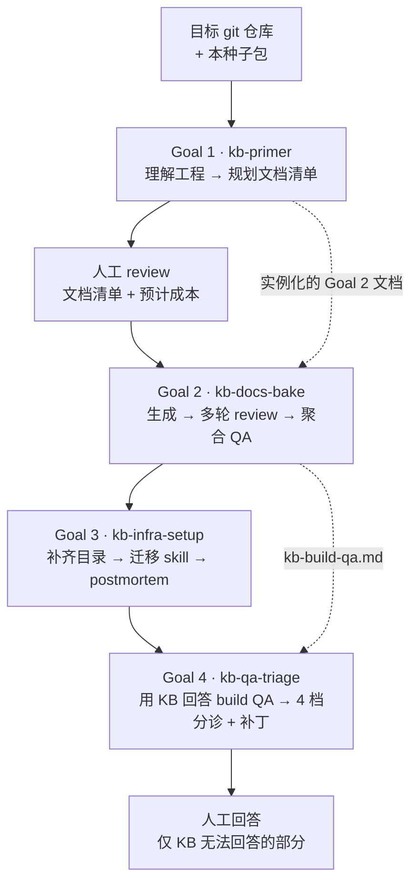

# Indexable Docs KB Seed

[English](README.md) · **简体中文**

> 一套可分发到任意 git 工程的结构化任务描述文档集合。目标工程的 AI Agent 读取后，能自主为该工程构建一份可检索、可维护的知识库。

知识库的默认四维记作 **AFMT**：Architecture（架构层）/ Flows（跨模块流程）/ Modules（模块权威源）/ Troubleshooting（排障）。当前协议按这四维实现：Stage B 分四个维度 sub-agent、`index.yaml` 分四段、schema 中 `dimension` 为固定枚举。

**维度集合是可演进的，但扩展发生在种子包这一层，而不是运行时配置。** 新增一个维度意味着更新种子包本身：补该维度的任务/模板/schema，必要时补一个 Stage，并同步调整 `GOAL_MET` 与成本口径——这是种子包的一次版本演进，不是使用方在运行期可以打开的开关。

区分这一点，是因为不同维度的**知识来源不同**：

| 来源 | 当前维度 | 怎么产出 |
|---|---|---|
| 从源码推导 | AFMT 四维 | sub-agent 读代码归纳，可自动化 |
| 构建后收纳 | `works/`（研发任务）；未来的 `meeting`（会议纪要）等 | 由人或会议沉淀，代码里读不出来，靠流程往里写 |

会议纪要这类知识无法从源码总结，形态更接近 `works/` 而不是 AFMT 四维。将来要收录它，应当**作为新维度引入种子包**（新增对应模板与 Stage），而不是硬塞进现有四维。

包名不绑定维度，正是为了让这种演进不产生改名成本。

## 使用方式

### 前置条件

- 目标工程必须是 git 仓库根目录（存在 `.git`）
- 目标工程尚未构建过知识库（不存在 `.think-tank/knowledge-base/index.yaml`）
- 支持 `/goal` 驱动多 Agent 编排的 Agent 环境（如 Claude Code、pi）
- API 配额充足（中型工程预计 10-15M tokens）

### 四步走（加一步元认知）

```bash
# 0. （推荐）先读 DESIGN-planning.md 建立元认知
#     理解为什么是四个 Goal、为什么 Stage A 要多维度取最大值、为什么要软收敛兜底……
#     知道 "why" 后遇到边缘情况才能合理判断，而不是死板套用任务文档

# 1. 复制种子包到目标工程的 .think-tank/ 下（目录不存在时先创建）
mkdir -p /path/to/target-project/.think-tank
cp -r indexable-docs-kb-seed /path/to/target-project/.think-tank/

# 2. 进入目标工程，启动 Goal 1
cd /path/to/target-project
# 在 Agent 中（Claude Code / pi）：/goal .think-tank/indexable-docs-kb-seed/primer.md

# 3. Goal 1 完成后会生成实例化的 Goal 2 任务文档，人类可 review 文档清单和"预计成本"章节，
#    然后启动 Goal 2 → Goal 3 → Goal 4
#    完整构建周期 = Goal 1 → Goal 2 → Goal 3 → Goal 4（默认全部执行）
#    Goal 4 (kb-qa-triage) 是最后一环，默认执行；仅当人类显式说"跳过 Goal 4"
#    或 explore-kb 未安装时才允许绕过

# 4. 若 pass/build-findings/ 有未确认条目，运行构建后的独立复核任务：
#    /goal .think-tank/knowledge-base/pass/build-findings/verify-build-findings.md
#    只有确认属实的条目才提升到 troubleshooting/known-bugs.md 或 works/。
```

## 文件清单

| 路径 | 类型 | 说明 |
|------|------|------|
| `VERSION` | 版本标识 | 单行版本号，Goal 1 会读取并写入 index.yaml.meta.seed_pack_version |
| `CHANGELOG.md` | 变更记录 | 各版本破坏性变更与迁移指南 |
| `DESIGN-planning.md` | 设计参考文档 | 种子包的完整设计规划（v8-ready）。**Agent 拿到种子包后应先通读此文档建立元认知**——理解每个 Goal / Stage / 决策的"为什么"，而不是仅照任务文档的"怎么做"执行 |
| `primer.md` | Goal 1 任务文档 | 直接被 `/goal` 驱动执行 |
| `bake.md.template` | Goal 2 模板 | Goal 1 Stage C 填充参数后生成 `bake-{project}.md` |
| `infra-setup.md` | Goal 3 任务文档 | 基础设施搭建 + Skill 迁移（Stage 6 目录补齐 → Stage 7 Skill 迁移 → Stage 8 完整性检查） |
| `qa-triage.md` | Goal 4 任务文档 | 全局视角 QA 分诊，将 kb-build-qa 分为 4 档。**种子包完整构建周期的最后一环，默认执行**（无需人类确认） |
| `verify-build-findings.md` | 构建后任务文档 | 对构建期发现的代码/流程问题进行独立复核。**不属于 KB 构建周期**；构建收官时复制到 `pass/build-findings/`。只有确认属实的条目才提升到 `troubleshooting/` 或 `works/` |
| `prompts/stage-a-subagent.md` | Prompt 模板 | Goal 1 Stage A 工程理解 sub-agent（含排除路径识别） |
| `prompts/stage-b-subagent.md` | Prompt 模板 | Goal 1 Stage B 文档清单规划 sub-agent（B2 输出含产品视角边界字段） |
| `prompts/stage-3-subagent.md` | Prompt 模板 | Goal 2 Stage 3 文档生成 sub-agent |
| `prompts/stage-4-subagent.md` | Prompt 模板 | Goal 2 Stage 4 Review sub-agent |
| `prompts/stage-5-aggregation.md` | Prompt 模板 | Goal 2 Stage 5 QA 聚合指令（含清理原始 jsonl） |
| `prompts/stage-qa-triage-subagent.md` | Prompt 模板 | Goal 4 Stage 11 QA 分诊 sub-agent |
| `schemas/stage-b-output.schema.json` | JSON Schema | Stage B sub-agent 输出格式（modules 段落含产品视角字段 required 定义） |
| `schemas/qa-jsonl-entry.schema.json` | JSON Schema | QA jsonl 每行的格式 |
| `schemas/goal2-task-doc.schema.yaml` | YAML Schema | Goal 2 任务文档的参数结构 |
| `schemas/qa-triage-output.schema.json` | JSON Schema | Goal 4 sub-agent 输出格式 |
| `schemas/discovered-issue.schema.json` | JSON Schema | 构建期发现账本（`pass/build-findings/discovered-issues.jsonl`） |
| `templates/meta-knowledge-base-guide.md.template` | 元规范模板 | 含 `{ADAPT}` 标记；§3.2 含产品视角字段规范 |
| `templates/meta-work-guide.md` | 通用模板 | 直接可用 |
| `templates/meta-runbook-guide.md` | 通用模板 | 直接可用 |
| `templates/meta-incident-guide.md` | 通用模板 | 直接可用 |
| `templates/kb-readme.md.template` | KB README 模板 | Goal 3 Stage 6 用于生成 KB 根 README |
| `skills/explore-kb/` | Skill | 去耦合版，Goal 3 Stage 7 迁移到 `.agents/skills/`（Claude Code 通过 `.claude` 兼容层读取同一份文件） |
| `skills/maintain-kb/` | Skill | 去耦合版，Goal 3 Stage 7 迁移到 `.agents/skills/` |
| `skills/commander/` | Skill | 模板化版。**模板层**仅含 `{{PROJECT_NAME}}` / `{{PROJECT_SLUG}}` 占位符；模块/流程清单在运行时从 `index.yaml` 读取，不再内联到 skill description。**示例层**取自 Redis 8.10.2（公共领域工程）。Goal 3 Stage 7 模板化迁移到 `.agents/skills/{{PROJECT_SLUG}}-commander/` |
| `knowledge-extract-qa-guide.md` | 关键元文档 | Goal 3 迁移到 KB 根目录，定义 QA 提取工作流 |

> **Skill 位置**：Goal 3 将 skill 安装到 `.agents/skills/`（pi / OpenCode 使用的跨 Agent 中立位置）。Claude Code 通过 `.claude` 兼容层读取——`.claude` 不存在时整目录软链到 `.agents`，已存在时只建立 `.claude/skills -> ../.agents/skills`，保留 `.claude` 下的其他配置；不维护第二份可编辑副本。

> **构建期发现**：构建 KB 时发现的代码/流程问题暂存到 `pass/build-findings/discovered-issues.jsonl`，**不是已确认的 KB 知识**，不进入 `kb-build-qa.md` 或 `troubleshooting/`。构建完成后由 `verify-build-findings.md` 独立复核；只有 `confirmed` 条目才提升到 `troubleshooting/known-bugs.md` 或 `works/`。

> **历史文件**：`templates/commander/` 与 `prompts/stage-commander-header-gen.md` 已不在本种子包内——模块的产品视角边界字段由 Goal 1 Stage B 直接产出并写入 `index.yaml.modules[]`，不再需要独立的 module_header 文件体系。

## 示例层与模板层的边界

- **模板层**：只含占位符（`{{PROJECT_NAME}}` / `{{PROJECT_SLUG}}`），迁移时替换为目标工程的值；模块/流程清单在运行时从 `index.yaml` 读取，不内联到 description；
- **示例层**：具体命令、模块 id、机制说明，取自 Redis 8.10.2（公共领域工程），仅作教学用，可整体替换或删除；
- 两层不得混写：模板层不写死具体工程的命令或 id，示例层不伪装成必须保留的内容。

## 顶层设计（速览）

构建流水线（结构视图；下面的文本补充每个 Goal 的细节）：



四个 Goal 的分工与产出（**Goal 1 → Goal 2 → Goal 3 → Goal 4** 依次执行，默认全部完成）：

```
Goal 1: kb-primer（分析 + 规划）
  输入：种子包 + 目标工程源码
  过程：工程理解 → 元规范推导 → 文档清单规划 → 实例化 Goal 2 任务文档
  产出：4 份 meta 文档 + KB 骨架 + index.yaml（含产品视角边界字段） + 完整的 Goal 2 任务文档

Goal 2: kb-docs-bake（确定性执行）
  输入：Goal 1 生成的实例化任务文档
  过程：文档内容生成（Stage 3） → 多轮 Review（Stage 4） → QA 聚合（Stage 5）
  产出：完整 KB 文档 + kb-build-qa.md（局部视角） + pass/build-findings/discovered-issues.jsonl（未确认）

Goal 3: kb-infra-setup（基础设施 + Skill）
  输入：Goal 2 产出的 KB
  过程：目录补齐 → Skill 迁移（explore-kb / maintain-kb / 可选 commander） → build-findings 快照 + postmortem + summary
  产出：就绪的 KB 运行环境 + pass/build-findings/ 快照与复核任务
  注：原「Commander 内容构建」Stage 已移除（产品视角字段由 Stage B 直接产出）

Goal 4: kb-qa-triage（种子包完整构建周期的最后一环）
  输入：Goal 3 完成的 KB + kb-build-qa.md
  过程：备份 kb-build-qa → 批并行分派 sub-agent 用 explore-kb 全局回答 → 重组为 4 档 + 生成 KB patch 建议 → 刷新 build-findings 快照
  产出：4 档分诊后的 kb-build-qa.md + pass/kb-doc-patches.md（人类批准后 apply） + 最终 build-findings 快照
  默认行为：Goal 3 完成后**默认自动启动**，无需人类确认。仅当人类显式说"跳过 Goal 4"或 explore-kb 未安装时才绕过
  价值：显著减少流入人类回答阶段的问题数量（通常减少 30-60%）

构建后（可选，不属于 4-Goal 周期）：
  任务：verify-build-findings.md
  输入：pass/build-findings/discovered-issues.jsonl + KB 快照
  产出：复核报告 + 状态回写；确认项提升到 troubleshooting/ 或 works/
```

详细设计见 `DESIGN-planning.md`（v8-ready，与本种子包同级）。

## 版本契约

种子包每次发布会更新 `VERSION` 文件。Goal 1 会将该版本号写入生成的 `index.yaml.meta.seed_pack_version`，供后续升级工具对照兼容性。

Tag 约定：

1. `VERSION` 是唯一版本源，其他位置不单独声明版本号；
2. 每次发布同步打 git tag（如 `v0.1.0`），tag 与 `VERSION` 内容必须一致；
3. 兼容性语义记录在 `CHANGELOG.md`，随发布同步更新；
4. 正文与代码注释中出现的 `v1.x` / `v2.0.x` 是种子包并入本仓库**之前**的结构演进编号（用于解释设计沿革），**不属于本仓库版本线**；KB 结构版本另见 `index.yaml.meta.kb_schema_version`。

## 迁移到其他工程

种子包不绑定任何具体工程；示例均取自公共领域工程（Redis 8.10.2）或为占位符。迁移到其他工程：

```bash
# 1. 拷贝整个种子包到目标工程
cp -r <seed-pack-dir> /path/to/target-project/.think-tank/

# 2. 确认目标工程满足前置条件
cd /path/to/target-project
[ -d .git ] && echo "✅ git 仓库" || echo "❌ 需要在 git 根目录"
[ -f .think-tank/knowledge-base/index.yaml ] && echo "❌ KB 已存在，需先删除" || echo "✅ KB 未构建"

# 3. 建议先读种子包内的 DESIGN-planning.md 建立元认知，再执行 Goal 1
```

**首次迁移建议**：
- 优先选择**架构形态差异较大**的工程（如纯 Web 服务、CLI 工具、数据管道）；
- 若担心风险，可先在一个 5-8 个模块的小型工程上完整走完全流程，再上真实工程；
- 迁移后请回收 `pass/kb-seed-postmortem.md` 中记录的问题，反馈到种子包维护端。

## 反馈

在生成的 `pass/kb-seed-postmortem.md` 中会记录本次构建的异常信号和流程优化建议。种子包维护者应定期回收这些 postmortem 用于改进种子包本身。
