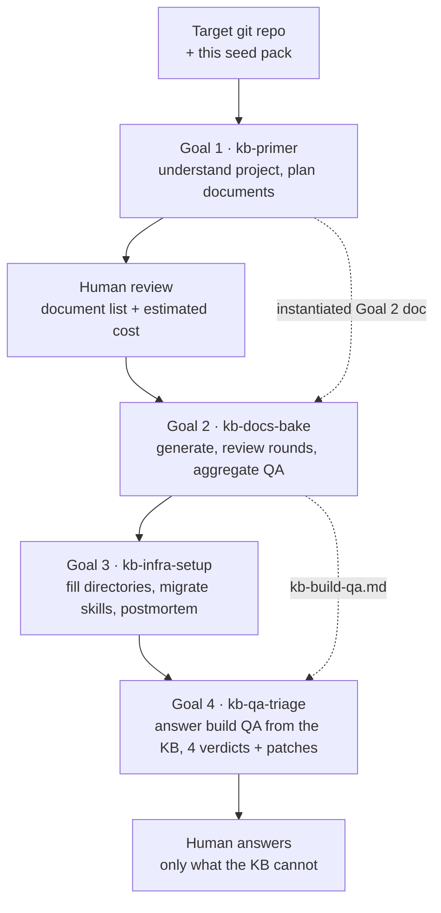

# Indexable Docs KB Seed

**English** · [简体中文](README-ZH.md)

> A distributable collection of structured task documents for any git repository. Once your project's AI agent reads it, the agent can build a searchable, maintainable knowledge base for that project on its own.

The knowledge base has four default dimensions, abbreviated **AFMT**: Architecture, Flows, Modules, and Troubleshooting. The current protocol implements exactly these four: Stage B dispatches one sub-agent per dimension, `index.yaml` has four sections, and `dimension` is a closed enum in the schema.

**The dimension set is meant to evolve — but that evolution happens at the seed-pack level, not as a runtime setting.** Adding a dimension means updating the seed pack itself: add the dimension's tasks/templates/schema, add a Stage if needed, and adjust the `GOAL_MET` criteria and cost model accordingly. It is a version bump of the seed pack, not a switch a consumer flips while running.

The distinction matters because different dimensions have different **sources of knowledge**:

| Source | Current dimensions | How they are produced |
|---|---|---|
| Derived from source code | The AFMT four | Sub-agents read code and summarize; fully automatable |
| Captured after the KB exists | `works/` (engineering tasks); a future `meeting` (meeting notes) dimension, etc. | Written by people or meetings; not derivable from code, captured through process |

Meeting notes cannot be summarized from source code, so they resemble `works/` rather than the AFMT four. If such a dimension is wanted later, it should be **introduced as a new dimension of the seed pack** (with its own templates and Stage), not squeezed into the existing four.

The pack name deliberately does not bind to any dimension set, so that this kind of evolution does not force another rename.

## Usage

### Prerequisites

- The target project is a git repository root (contains `.git`)
- The target project has no knowledge base yet (`.think-tank/knowledge-base/index.yaml` does not exist)
- A Claude Code environment that supports `/goal`-driven multi-agent orchestration
- Sufficient API quota (a medium-sized project is estimated at 10–15M tokens)

### Four steps (plus a meta step)

```bash
# 0. (Recommended) Read DESIGN-planning.md first to build the mental model
#     Understand why there are four Goals, why Stage A takes the maximum across
#     dimensions, why there is a soft-convergence fallback...
#     Knowing the "why" lets you judge edge cases instead of applying the docs mechanically.

# 1. Copy the seed pack into the target project's .think-tank/ (create it first if missing)
mkdir -p /path/to/target-project/.think-tank
cp -r indexable-docs-kb-seed /path/to/target-project/.think-tank/

# 2. Enter the target project and start Goal 1
cd /path/to/target-project
# In Claude Code: /goal .think-tank/indexable-docs-kb-seed/primer.md

# 3. When Goal 1 finishes it produces an instantiated Goal 2 task document.
#    A human reviews the document list and the "estimated cost" section,
#    then runs Goal 2 -> Goal 3 -> Goal 4.
#    Full cycle = Goal 1 -> Goal 2 -> Goal 3 -> Goal 4 (all run by default).
#    Goal 4 (kb-qa-triage) is the last link and runs by default; it may only be
#    skipped if a human explicitly says "skip Goal 4" or explore-kb is not installed.
```

## File layout

| Path | Type | Purpose |
|------|------|---------|
| `VERSION` | Version marker | Single-line version number; Goal 1 reads it into `index.yaml.meta.seed_pack_version` |
| `CHANGELOG.md` | Change log | Breaking changes and migration guidance per version |
| `DESIGN-planning.md` | Design reference | The full design rationale (v8-ready). **Agents should read this first** — understand the "why" behind each Goal / Stage / decision instead of only following the "how" |
| `primer.md` | Goal 1 task document | Driven directly by `/goal` |
| `bake.md.template` | Goal 2 template | Goal 1 Stage C fills in parameters and produces `bake-{project}.md` |
| `infra-setup.md` | Goal 3 task document | Infrastructure + Skill migration (Stage 6 directories → Stage 7 Skills → Stage 8 completeness check) |
| `qa-triage.md` | Goal 4 task document | Global QA triage, splitting `kb-build-qa` into four buckets. **The last link of the full cycle; runs by default** (no human confirmation needed) |
| `prompts/stage-a-subagent.md` | Prompt template | Goal 1 Stage A project-understanding sub-agent (includes excluded-path detection) |
| `prompts/stage-b-subagent.md` | Prompt template | Goal 1 Stage B document-list planning sub-agent (B2 emits product-boundary fields) |
| `prompts/stage-3-subagent.md` | Prompt template | Goal 2 Stage 3 document generation sub-agent |
| `prompts/stage-4-subagent.md` | Prompt template | Goal 2 Stage 4 review sub-agent |
| `prompts/stage-5-aggregation.md` | Prompt template | Goal 2 Stage 5 QA aggregation (includes raw jsonl cleanup) |
| `prompts/stage-qa-triage-subagent.md` | Prompt template | Goal 4 Stage 11 QA triage sub-agent |
| `schemas/stage-b-output.schema.json` | JSON Schema | Stage B sub-agent output (modules sections require product-view fields) |
| `schemas/qa-jsonl-entry.schema.json` | JSON Schema | Format of each line in a QA jsonl file |
| `schemas/goal2-task-doc.schema.yaml` | YAML Schema | Parameter structure of the Goal 2 task document |
| `schemas/qa-triage-output.schema.json` | JSON Schema | Goal 4 sub-agent output |
| `templates/meta-knowledge-base-guide.md.template` | Meta-spec template | Contains `{ADAPT}` markers; §3.2 covers product-view fields |
| `templates/meta-work-guide.md` | Generic template | Usable as-is |
| `templates/meta-runbook-guide.md` | Generic template | Usable as-is |
| `templates/meta-incident-guide.md` | Generic template | Usable as-is |
| `templates/kb-readme.md.template` | KB README template | Used by Goal 3 Stage 6 to generate the KB root README |
| `skills/explore-kb/` | Skill | Decoupled; migrated to `.claude/skills/` in Goal 3 Stage 7 |
| `skills/maintain-kb/` | Skill | Decoupled; migrated to `.claude/skills/` in Goal 3 Stage 7 |
| `skills/commander/` | Skill | Templated. **Template layer** holds only `{{PROJECT_NAME}}` / `{{PROJECT_SLUG}}` / `{{MODULE_LIST}}` / `{{FLOW_LIST}}`; **example layer** comes from Redis 8.10.2 (a public project). Migrated to `.claude/skills/{{PROJECT_SLUG}}-commander/` in Goal 3 Stage 7 |
| `knowledge-extract-qa-guide.md` | Key meta document | Migrated to the KB root by Goal 3; defines the QA extraction workflow |

> **Retired files**: `templates/commander/` and `prompts/stage-commander-header-gen.md` are no longer part of this pack — product-boundary fields are produced directly by Goal 1 Stage B and written into `index.yaml.modules[]`, so a standalone `module_header` file system is no longer needed.

## Example layer vs. template layer

- **Template layer**: placeholders only (`{{PROJECT_NAME}}` / `{{PROJECT_SLUG}}` / `{{MODULE_LIST}}` / `{{FLOW_LIST}}`), replaced with the target project's values during migration.
- **Example layer**: concrete commands, module ids, and mechanism notes taken from Redis 8.10.2 (a public project). Teaching material only — it can be replaced wholesale or deleted.
- The two layers must not be mixed: the template layer never hard-codes a specific project's commands or ids, and the example layer never masquerades as content that must be kept.

## Top-level design (at a glance)

The build pipeline — structure view. The text below adds per-Goal detail.



The four Goals and their outputs (**Goal 1 → Goal 2 → Goal 3 → Goal 4**, in order, all by default):

```
Goal 1: kb-primer (analysis + planning)
  Input:  seed pack + target project source
  Steps:  project understanding -> meta-spec derivation -> document list planning -> instantiated Goal 2 doc
  Output: 4 meta documents + KB skeleton + index.yaml (with product-boundary fields) + full Goal 2 task document

Goal 2: kb-docs-bake (deterministic execution)
  Input:  the instantiated task document from Goal 1
  Steps:  document generation (Stage 3) -> multi-round review (Stage 4) -> QA aggregation (Stage 5)
  Output: complete KB documents + kb-build-qa.md (local view)

Goal 3: kb-infra-setup (infrastructure + Skills)
  Input:  the KB produced by Goal 2
  Steps:  fill in directories -> migrate Skills (explore-kb / maintain-kb / commander) -> postmortem + summary
  Output: a ready-to-run KB environment
  Note:   the former "Commander content build" Stage is gone (Stage B emits product-view fields directly)

Goal 4: kb-qa-triage (the last link of the full cycle)
  Input:  the KB from Goal 3 + kb-build-qa.md
  Steps:  back up kb-build-qa -> batch-dispatch sub-agents that answer via explore-kb -> regroup into 4 verdict buckets + KB patch suggestions
  Output: triaged kb-build-qa.md + pass/kb-doc-patches.md (applied after human approval)
  Default: starts automatically after Goal 3, no confirmation needed. Skipped only if a human says
           "skip Goal 4" or explore-kb is not installed.
  Value:  typically cuts the number of questions that reach humans by 30-60%
```

Detailed design lives in `DESIGN-planning.md` (v8-ready, alongside this README).

## Version contract

The seed pack updates `VERSION` on every release. Goal 1 writes that version into the generated `index.yaml.meta.seed_pack_version` so future upgrade tooling can check compatibility.

Tag conventions:

1. `VERSION` is the single source of truth; no other file declares a version independently.
2. Every release is tagged (e.g. `v0.2.1`), and the tag must match `VERSION`.
3. Compatibility semantics are recorded in `CHANGELOG.md`, updated with each release.
4. Occurrences of `v1.x` / `v2.0.x` in prose and code comments are **structural evolution numbers from before this repository existed** (they explain design lineage) and are **not part of this repository's version line**. The KB schema version is separate — see `index.yaml.meta.kb_schema_version`.

## Migrating to another project

The pack is not bound to any specific project; all examples come from a public project (Redis 8.10.2) or are placeholders. To migrate:

```bash
# 1. Copy the whole seed pack into the target project
cp -r <seed-pack-dir> /path/to/target-project/.think-tank/

# 2. Verify the target project meets the prerequisites
cd /path/to/target-project
[ -d .git ] && echo "OK: git repo" || echo "FAIL: must be the git root"
[ -f .think-tank/knowledge-base/index.yaml ] && echo "FAIL: KB already exists, remove it first" || echo "OK: KB not built yet"

# 3. Read DESIGN-planning.md inside the pack before running Goal 1
```

**Advice for a first migration**:

- Prefer a project whose **architecture shape differs notably** from the last one you ran (a plain web service, a CLI tool, a data pipeline).
- If risk-averse, run the full cycle on a small project with 5–8 modules before using a real one.
- Afterwards, collect the issues recorded in `pass/kb-seed-postmortem.md` and feed them back to the pack maintainers.

## Feedback

Each run records anomaly signals and process-improvement suggestions in `pass/kb-seed-postmortem.md`. Maintainers should periodically harvest those postmortems to improve the seed pack itself.
