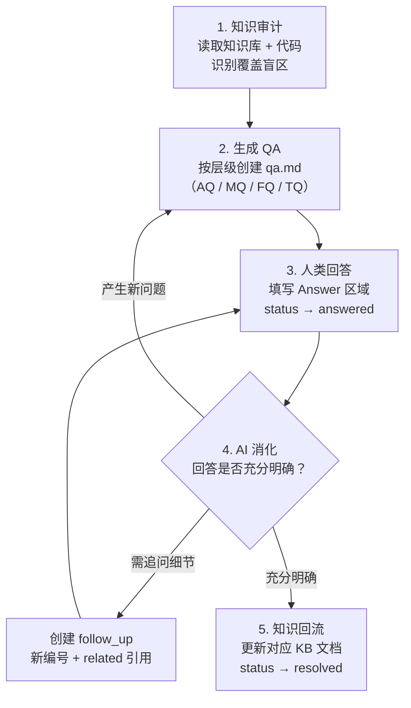
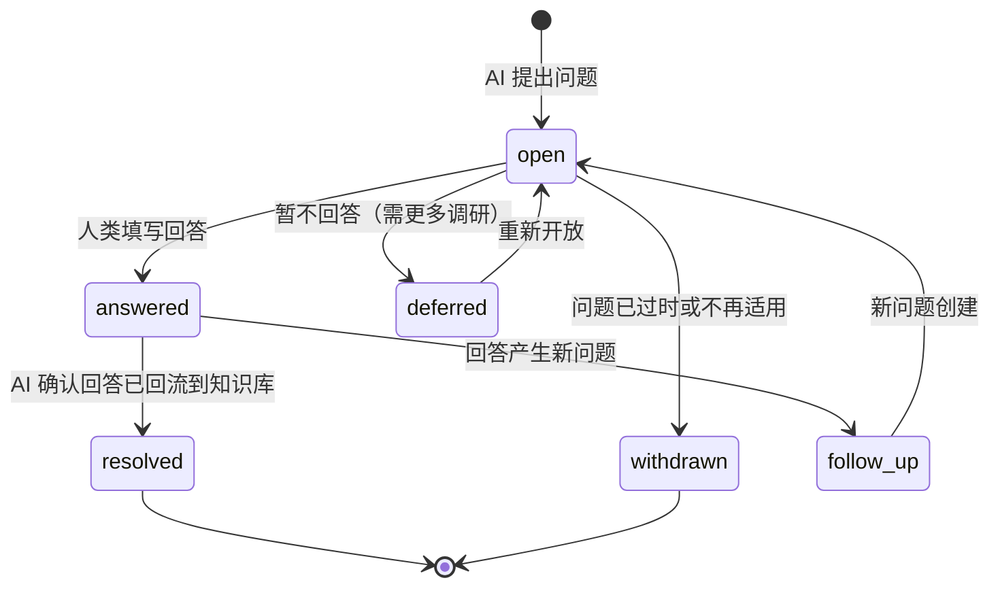

# 知识库隐性知识提取指南

> 本文档定义了 AI Agent 通过结构化提问从人类团队提取隐性知识、并将其回流到知识库的完整工作流。
>
> 本指南是**通用文档**——可复制到任意具备 `.think-tank/knowledge-base` 结构的仓库中使用，不依赖具体项目内容。

---

## 1. 解决什么问题

一个按照代码/文档构建的知识库，天然存在一类盲区：**当前仓库的代码和文档无法体现、无法回答的问题**。例如：

- 测试策略与覆盖率
- 性能基准与瓶颈
- 原始设计决策与历史权衡
- 生产部署拓扑与运维 SOP
- 已知限制与未修复的 bug
- 安全威胁模型与审计结果

这些信息完全掌握在人类团队的头脑中，AI 无法仅通过阅读代码和文档获取。本指南定义的 QA 工作流，就是通过 **AI 结构化提问 → 人类团队回答 → AI 追问收敛 → 知识回流到知识库** 的闭环，将这些隐性知识显性化。

---

## 2. 前置条件检查

在开始提问之前，AI Agent **必须**完成以下检查，并向人类确认：

### 2.1 知识库结构检查

确认当前仓库的 `.think-tank/knowledge-base/` 目录下存在以下内容：

| 检查项 | 路径 | 说明 |
|--------|------|------|
| 知识库构建规范 | `.meta-knowledge-base-guide.md` | 定义了知识库的构建原则、代码范围边界、文档规范 |
| 知识库索引 | `index.yaml` | 列出所有知识文档及其关键词、覆盖代码范围 |
| 架构层目录 | `architecture/` | 含架构级认知文档（全景、技术栈、契约等） |
| 模块层目录 | `modules/` | 含模块级权威知识文档 |
| 流程层目录 | `flows/` | 含跨模块端到端流程文档 |

可选但建议存在：

| 检查项 | 路径 | 说明 |
|--------|------|------|
| 排查层目录 | `troubleshooting/` | 含故障排查条目和索引 |
| QA 模板 | `qa-template.md` | 问题条目格式规范（本指南 §4 已内嵌模板） |

如果上述核心目录/文件缺失，应先完成知识库的基础构建（参考 `.meta-knowledge-base-guide.md`），再进入提问阶段。

### 2.2 完整度确认

在开始分析代码和生成问题前，**必须向人类确认**：

> 当前知识库文档是否已构建完整？若知识库文档尚不完整，AI 提出的问题可能数量过多、质量偏低，不利于高效完成知识提取。是否继续？

只有人类明确表示"知识库已足够完整，可以开始提问"后，才能进入下一阶段。

---

## 3. 工作流总览



### 阶段 1：知识审计

AI Agent 读取 `index.yaml` 获取全量知识文档列表，然后阅读每份文档的内容，识别其覆盖了什么、**没覆盖什么**。重点寻找以下信号：

- 文档中没有任何测试相关描述 → 产生测试策略问题
- 文档中缺少性能数据或 SLA → 产生性能目标问题
- 代码中存在非直觉的设计选择，文档未解释原因 → 产生设计决策问题
- 文档描述了"怎么做"但没描述"为什么这么做" → 产生背景动机问题
- 文档描述了正常路径但缺少异常路径 → 产生错误处理/降级问题
- 代码中存在 `TODO` / `FIXME`，文档未追踪 → 产生已知问题/技术债问题

### 阶段 2：生成 QA 文件

按知识库层级，在对应目录下创建 `qa.md`：

| 层级 | 输出路径 | 编号前缀 | 聚焦领域 |
|------|---------|---------|---------|
| 架构层 | `architecture/qa.md` | `AQ-XXX` | 全局设计决策、产品战略、部署拓扑、SLA、威胁模型 |
| 模块层 | `modules/qa.md` | `MQ-XXX` | 单模块的测试策略、已知限制、性能特征、配置依据 |
| 流程层 | `flows/qa.md` | `FQ-XXX` | 跨模块流程的异常路径、超时重试、监控埋点、集成测试 |
| 排查层 | `troubleshooting/qa.md` | `TQ-XXX` | 真实事故、监控告警、运维 SOP、安全响应 |

每个文件只包含该层级的问题。问题编号连续递增，不复用已撤回的编号。新增问题追加到文件末尾。

### 阶段 3：人类团队回答

将生成的 `qa.md` 文件交付给人类团队。人类团队在每个问题的 `> **Answer**:` 区域填写回答，完成后将 `status` 从 `open` 改为 `answered`。

人类团队可能给出：
- **完整回答**：所有子问题均已答复
- **部分回答**：部分子问题回答，其余标注 `不确定`
- **特殊回答**：`不确定` / `无此信息` / `取决于场景` / `暂缓回答` / `参见其他问题`（详见 §4.4）
- **引出新问题**：回答中提到了之前未覆盖的盲区

### 阶段 4：AI 消化与追问

人类回答后，AI Agent 应：

1. 逐条阅读每个 `answered` 问题的答案
2. 判断回答是否足够明确、可操作：
   - **足够明确** → 准备回流到知识库文档
   - **存在模糊或矛盾** → 创建 `follow_up` 问题（新编号，`related` 字段引用原编号），追问细节
   - **引出新盲区** → 创建新问题条目
3. 重复阶段 3-4，直至所有问题收敛

> 追问不限于一层——例如架构问题的答案可能引出一个模块级的新问题，此时应在 `modules/qa.md` 中创建新条目并跨层引用。

### 阶段 5：知识回流

当问题的回答已充分明确后，AI Agent 应：

1. 将回答中的关键信息更新到对应的知识库文档中（架构问题的答案更新 `architecture/*.md`，模块问题的答案更新 `modules/*.md`，以此类推）
2. 在该问题的 `> **Answer**:` 末尾追加回流记录：`> **回流**: 已更新至 <目标文档> §<章节>（<日期>）`
3. 将 `status` 从 `answered` 改为 `resolved`
4. 如有必要，更新 `index.yaml` 中对应文档的 keywords / description

**回流原则**：
- 信息只写入其归属的权威文档（模块层问题 → 对应模块文档，流程层问题 → 对应流程文档）
- 避免在 `qa.md` 中保留"已回流"的冗余信息——`qa.md` 是临时工作区，最终知识应沉淀到正式知识库文档
- 回流后的 `qa.md` 条目保留作为审计追溯，但 `status: resolved` 明确标记已完成

---

## 4. 问题条目规范

### 4.1 五个提问原则

1. **有据可查**：每个问题必须附带 `背景` 字段，引用代码/文档中的具体观察（文件名、行号、章节），说明问题从何而来，不可凭空提问
2. **具体可答**：`希望了解` 中的每个子问题应可被一句话或一段话回答，避免 `请全面描述 XX` 式的开放问题
3. **非重复**：提问前检查是否已有相同或高度相关的问题——先在当前 QA 文件中搜索，再跨层级检查
4. **分层聚焦**：架构问题问全局决策，模块问题问实现细节，流程问题问跨模块衔接与异常路径，排查问题问运维经验
5. **优先级合理**：
   - `high`：影响知识库核心正确性（如 S3 兼容性范围、设计决策依据），阻塞后续开发决策
   - `medium`：有助于完善理解（如测试覆盖率、配置依据），但不阻塞核心判断
   - `low`：锦上添花（如历史趣闻、未来可能有用但当前不急的信息）

### 4.2 领域速查

以下领域是代码/文档通常无法覆盖的隐性知识重点，应在知识审计时逐项检查：

| 领域 | 典型问题类型 | 适合层级 |
|------|-------------|---------|
| 测试策略 | 如何测试？覆盖率？测试框架？集成测试环境？ | 模块层、流程层 |
| 性能数据 | P99 延迟？QPS 上限？瓶颈在哪？profiling 结果？ | 架构层、模块层 |
| 设计决策 | 为什么选 A 不选 B？历史背景？曾经尝试过什么？ | 架构层 |
| 部署运维 | 实例数？资源配置？K8s 探测配置？滚动更新策略？ | 架构层、排查层 |
| 已知限制 | 已知 bug？不支持的操作？有意的行为差异？ | 模块层 |
| 安全合规 | 威胁模型？审计历史？安全响应流程？ | 架构层、排查层 |
| 跨仓协作 | 与外部仓库的协调机制？接口变更流程？ | 架构层、模块层 |
| 事故经验 | 真实线上事故？根因分布？事后复盘？ | 排查层 |
| 监控告警 | 关键指标？告警阈值？Dashboard？ | 排查层 |
| 演进路线 | 技术债清单？重构计划？未来架构目标？ | 架构层 |

### 4.3 空白模板（快速复制）

```markdown
## <编号> · <问题简称>

**status**: `open`
**priority**: `<high | medium | low>`
**asked_by**: `AI`
**answer_by**: ``
**related**: ``

<一段话概述问题>

**背景**：<从代码/文档中观察到的现象和疑点，引用具体文件/章节>

**希望了解**：
1. <子问题 1>
2. <子问题 2>
3. <子问题 3>

> **Answer**:

---
```

### 4.4 qa.md 文件结构

每个 `qa.md` 文件由文件级 front matter、文档头部和问题条目列表三部分组成。

#### 4.4.1 文件级 Front Matter（YAML 头）

```yaml
---
id: <层级>-qa               # 如 architecture-qa, modules-qa
title: "<层级名称> · 待澄清问题清单"
status: active
tags: [QA, <层级标签>, 待确认, 人工输入, 知识盲区]
created: <创建日期>
last_updated: <最后更新日期>
---
```

#### 4.4.2 文档头部

Front matter 之后是一级标题和文档说明，包含：

- 一句话描述本文档用途
- 问题编号规则说明
- 回答指南引用（指向本 guide §4.7 或独立的 `qa-template.md`）
- 问题状态流转简要说明

示例：

```markdown
# <层级名称> · 待澄清问题清单

> 本文档列出<层级>无法从现有代码/文档中回答的问题。编号规则：`<前缀>-XXX`，
> 按追加顺序递增。
>
> **回答指南**：在 `> **Answer**:` 下方书写，保持引用块格式。
> 允许 `不确定` / `无此信息` / `取决于场景` / `暂缓回答` / `参见其他问题`。
> 请勿猜测或编造信息。详见 knowledge-extract-qa-guide.md §4.7。
>
> 问题状态流转：`open` → `answered` → `resolved`；
> 或 `open` → `deferred` / `withdrawn`。
```

#### 4.4.3 问题条目格式

每个问题为一个独立的二级标题（`##`），包含元数据区、问题描述区和回答区：

```markdown
## <编号> · <问题简称>

**status**: `open`
**priority**: `<high | medium | low>`
**asked_by**: `AI`
**answer_by**: ``
**related**: ``

<一段话概述问题>

**背景**：<从代码/文档中观察到的现象和疑点，引用具体文件/章节>

**希望了解**：
1. <子问题 1>
2. <子问题 2>
3. <子问题 3>

> **Answer**:

---
```

### 4.5 字段说明

| 字段 | 必填 | 说明 |
|------|------|------|
| `status` | 是 | 问题状态，取值见 §5 状态流转 |
| `priority` | 是 | 优先级：`high`（阻塞知识库质量）、`medium`（有助于完善）、`low`（锦上添花） |
| `asked_by` | 是 | 提问者：`AI`（自动分析产生）或人名（人工补充的问题） |
| `answer_by` | 否 | 回答者姓名或角色，回答时填写 |
| `related` | 否 | 关联的其他 QA 问题编号（跨层级也可引用，如 `AQ-003` 引用 `MQ-007`） |
| **背景** | 是 | 必须说明问题的来源证据（代码行号、文档章节、配置项等），不可凭空提问 |
| **希望了解** | 是 | 必须拆分为具体、可回答的子问题，避免过于宽泛 |

### 4.6 编号分配规则

- 每个 `qa.md` 文件内编号**连续递增**，不复用已撤回的编号
- 新增问题**追加到文件末尾**，不插入中间
- 需要对已关闭问题追问时，创建**新编号**并在 `related` 中引用原编号
- 跨层级引用时引用完整路径，如 `参见 modules/qa.md 中 MQ-012 的回答`

### 4.7 回答规范（面向人类回答者）

#### 4.7.1 回答格式

在 `> **Answer**:` 下方直接书写，保持 Markdown 引用块格式：

```markdown
> **Answer**:
> **answer_by**: <姓名或角色> (<回答日期>)
>
> 1. <回答子问题 1>
> 2. <回答子问题 2>
>
> 补充说明：<可选>
```

回答完成后，将 `status` 从 `open` 改为 `answered`，并填写 `answer_by` 字段。

#### 4.7.2 允许的特殊回答

并非所有问题都有确定答案。以下特殊回答**完全合规**，请如实标注：

| 特殊回答 | 使用场景 | 格式示例 |
|---------|---------|---------|
| **不确定** | 回答者不掌握该信息，也无法在合理时间内确认 | `> 不确定。该决策是早期做出的，相关人员已离职，无文档记录。` |
| **无此信息** | 该问题涉及的设计从未被明确讨论或决策过 | `> 无此信息。目前没有针对此场景的设计考量。` |
| **取决于场景** | 答案因部署环境/客户而异 | `> 取决于场景。对于场景 A 是 X，对于场景 B 是 Y。` |
| **暂缓回答** | 需要进一步调研、讨论或等待上游决策 | `> 暂缓。需要等架构评审结论。` 并将 status 改为 `deferred` |
| **参见其他问题** | 其他 QA 中已有相同/相关回答 | `> 参见 MQ-005 的回答。补充说明：...` |

> **请勿**为了给出"完整答案"而猜测或编造信息。`不确定` 比错误答案对知识库的价值更高。

#### 4.7.3 敏感信息脱敏

回答中如涉及以下敏感信息，**必须进行脱敏处理**：

| 敏感类型 | 脱敏方式 | 示例 |
|---------|---------|------|
| 客户名称 | 使用代号或泛化描述 | `某企业云盘客户` 或 `客户 A` |
| 内部 IP / 域名 | 使用占位符 | `<内部IP>` 或 `internal-server.example.com` |
| API Key / Token | 不得出现 | `<API_KEY>` |
| 安全漏洞细节 | 仅描述类别和影响，不暴露利用方法 | `存在未认证的访问风险，已在 v2.1 修复` |
| 商业数据 | 使用量级描述 | `日活万级` |
| 员工真实姓名 | 如非必要，使用角色代替 | `模块负责人` |

#### 4.7.4 跨问题引用

当多个问题的答案存在关联时：

- **同层级引用**：`参见 AQ-003 的回答，一致性模型同样适用于此场景。`
- **跨层级引用**：`参见 modules/qa.md 中 MQ-012 的回答。`
- **双向关联**：如果回答 AQ-005 时引用了 MQ-012，也应在 MQ-012 的 `related` 字段中补充 `AQ-005`。

#### 4.7.5 部分回答

如果只能回答部分子问题，**请尽管回答**已知的部分，对未知部分标注 `不确定`：

```markdown
> **Answer**:
> **answer_by**: 模块负责人 (YYYY-MM-DD)
>
> 1. 最低支持版本：<产品/平台的最低版本>。
> 2. 仅支持 <格式/协议 A>，不支持 <格式/协议 B>。
> 3. 不确定。<未测试/未覆盖的场景说明>。
```

---

## 5. 状态流转



| 状态 | 含义 |
|------|------|
| `open` | 待回答 |
| `answered` | 已回答，等待 AI 消化并回流到知识库文档 |
| `resolved` | 已回流，问题关闭 |
| `deferred` | 暂缓回答（需进一步调研或等待决策） |
| `follow_up` | 回答中引出了新的子问题 |
| `withdrawn` | 问题撤回（代码已变更或问题不再成立） |

---

## 6. 文件命名与放置约定

| 问卷范围 | 文件路径 | 编号前缀 |
|---------|---------|---------|
| 架构层（全局性、跨模块） | `architecture/qa.md` | `AQ-XXX` |
| 流程层（端到端流程相关） | `flows/qa.md` | `FQ-XXX` |
| 模块层（单模块实现细节） | `modules/qa.md` | `MQ-XXX` |
| 故障排查层 | `troubleshooting/qa.md` | `TQ-XXX` |

每个目录下最多一个 `qa.md`，所有该层级的问题集中管理。

---

## 7. 完整示例：从提问到回流

> 示例取自 Redis 8.10.2（公共领域工程），仅作教学示例；迁移到本工程后应替换为等价场景。

以下示例展示一个架构层问题的完整生命周期，帮助理解工作流各阶段的输入输出。

### 7.1 AI 提出问题

```markdown
## AQ-001 · 设计决策：为何维护复制积压缓冲，而不是每次断链都全量重同步

**status**: `open`
**priority**: `high`
**asked_by**: `AI`
**answer_by**: ``
**related**: ``

主从复制在断链重连时优先走部分重同步（`PSYNC` 返回 `CONTINUE`），
而不是重新做一次全量传输。代码里对应共享的积压缓冲与偏移比对
（见 `modules/replication.md` §4.2、`flows/replication-sync-flow.md` §2）。

**背景**：
- 握手阶段 `PSYNC` 只有两种结局：`FULLRESYNC` 或 `CONTINUE`
  （见 `flows/replication-sync-flow.md` §2）
- 积压缓冲按「写命令字节流」累积，超出 `repl-backlog-size` 后从头覆盖
  （见 `modules/replication.md` §5）
- 代码未说明积压容量的规划依据

**希望了解**：
1. 为什么用「共享积压缓冲 + 偏移比对」而不是只在副本侧记录已确认位置？
2. `repl-backlog-size` 的默认值与容量规划依据是什么？
3. 积压被覆盖后是否只能全量，有没有可观测的预兆？

> **Answer**:
```

### 7.2 人类回答

```markdown
> **Answer**:
> **answer_by**: 模块负责人 (YYYY-MM-DD)
>
> 1. 判定「这段变更还能不能补」需要主侧的权威视图：副本上报的确认偏移可能滞后，
>    而积压缓冲是主侧连续写命令流的窗口，两者一比就能确定副本缺失的起点是否还在窗口内。
> 2. 默认值是按「中小实例的典型写入速率 × 可容忍的断链时长」取的保守量。
>    规划方法是看峰值写入字节速率，乘以你希望容忍的断链秒数，再留一倍余量。
> 3. 一旦副本的偏移落在窗口之外只能全量。可观测预兆是 `INFO replication` 里
>    积压区间与副本偏移的差距持续收窄，以及 `sync_full` 计数上升。
```

### 7.3 AI 判断与追问

AI 判断回答中的第 2 点不够可操作，创建追问：

```markdown
## AQ-008 · 如何把「峰值写入速率」换算成 `repl-backlog-size`（追问 AQ-001）

**status**: `open`
**priority**: `medium`
**asked_by**: `AI`
**answer_by**: ``
**related**: `AQ-001`

AQ-001 的回答给出「速率 × 容忍时长 × 2」的规划方法，
但没有说明速率从哪里读、以及单位如何换算。

**背景**：
- AQ-001 回答第 2 点：峰值写入字节速率 × 断链容忍秒数 × 2
- `modules/replication.md` §2 未给出积压缓冲的字节口径

**希望了解**：
1. 峰值写入速率应该读哪个指标（命令数？字节数？）？
2. 主实例与从实例的积压缓冲是否独立计算？
3. 调大积压缓冲的内存代价如何估算？

> **Answer**:
```

### 7.4 人类再次回答后 AI 回流

假设 AQ-001 和 AQ-008 的回答都已充分明确，AI 将知识回流：

- AQ-001 的第 1 点 → 更新 `modules/replication.md`，在 §5「设计决策与权衡」补一节「为什么以主侧积压窗口做续传判定」
- AQ-001 的第 3 点 + AQ-008 的全部回答 → 更新 `flows/replication-sync-flow.md` 的 §4「异常路径」，补上「积压失效 → 全量重同步」的判定与观测信号
- 两个问题的 status → `resolved`
- 在每个问题的 Answer 末尾追加回流记录

---

## 8. 快速启动检查清单

AI Agent 每次被要求进行知识提取时，按以下清单操作：

- [x] 读取 `index.yaml`，确认知识库结构完整
- [x] 读取 `.meta-knowledge-base-guide.md`，理解知识库的构建原则和代码范围边界
- [x] 向人类确认知识库完整度（§2.2）
- [x] 逐篇阅读知识库文档，标记"代码无法回答"的盲区（对照 §4.2 领域速查）
- [x] 按层级生成 `qa.md` 文件（§4.3 模板），每个问题附带具体背景
- [x] 将 `qa.md` 交付人类团队，明确告知回答规范（§4.4）
- [ ] 收到回答后：判断是否明确 → 追问或回流 → 更新 `status`
- [ ] 回流完成后，更新对应知识库文档，标记 `status: resolved`
