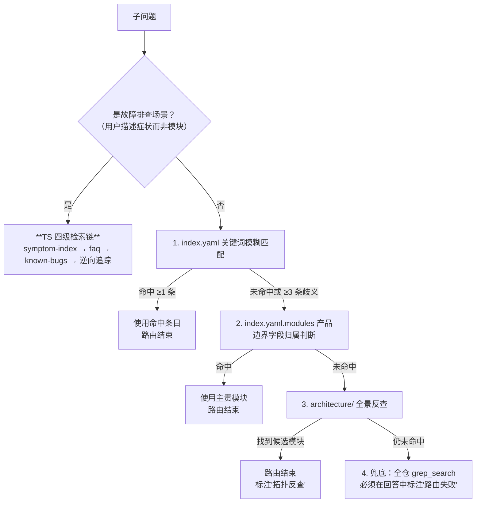
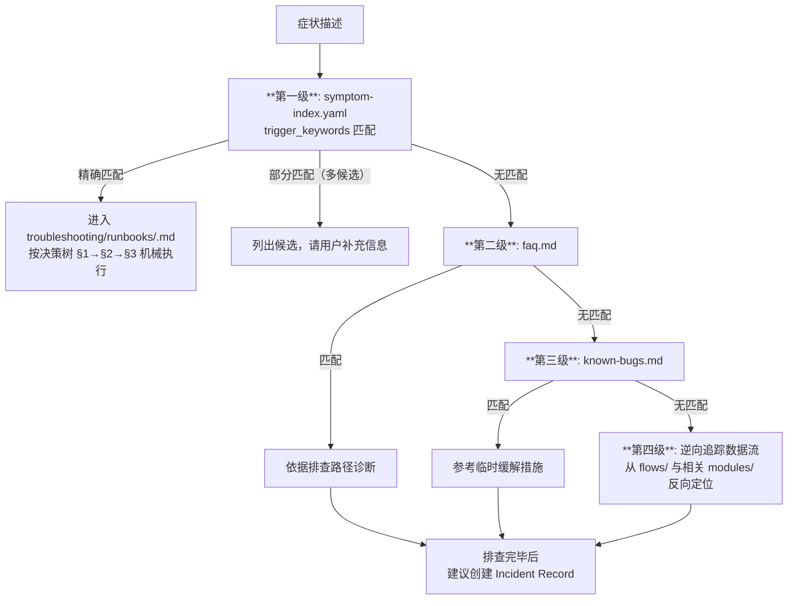

# {{PROJECT_SLUG}} · 路由规则（routing-rules.md）

> 示例说明：本文中的具体命令、模块 id 与机制示例取自 Redis 8.10.2（公共领域工程），仅作教学示例，不属于模板变量；`{{PROJECT_NAME}}` / `{{PROJECT_SLUG}}` 为迁移时需替换的占位符。

> 本文展开 `SKILL.md` §1 Step 2 的路由细节、TS 四级检索链、跨模块并行下钻规则与路由质量自检。

---

## 1. 路由匹配链（按顺序尝试，命中即停）

{{PROJECT_NAME}} 是单仓库结构，没有子仓（submodule）。路由链因此比多仓结构简化，四阶段：



### 阶段 1：`index.yaml` 关键词匹配

- 优先精确匹配 `keywords` 列表中的词（中英文均可）；
- 子问题包含的多个词均能匹配同一条目时优先命中；
- 命中条目数 ≥ 3 视为歧义，进入阶段 2；
- 也可匹配 `covers_code`（用户提及具体源文件时）与 `covers_commands`（用户提及 {{PROJECT_NAME}} 命令时）；
- **注意**：`index.yaml` 的组织按 `architecture` / `modules` / `flows` / `troubleshooting` 分段（`develop` 与 `works` 段当前为空，无条目可匹配）。用户问题类型对应哪一段：
  - "怎么工作 / 什么是 / 数据模型" → `modules` 优先；
  - "命令执行流程 / 主从同步流程 / 槽迁移流程" → `flows` 优先；
  - "什么架构 / 什么技术栈 / 部署" → `architecture` 优先；
  - "错误 / 失败 / 报错" → 走 TS 四级检索链（下文 §2）；
  - "编码约定 / 研发规范" → 直接读 `architecture/tech-stack.md`；
  - "为什么这样设计（涉及具体历史决策）" → `modules/<id>.md` §5 设计决策与权衡 + git log。

### 阶段 2：`index.yaml.modules[]` 产品边界字段归属判断

- **用途**：阶段 1 未命中或多义时，用 `modules[<id>]` 中的 `responsibility` / `capability_boundary` / `communicates_with` 字段从产品职责角度锁定主责模块；
- **数据位置**（v2.0 起）：这些字段**已内嵌于 index.yaml.modules[]**，无需再读独立的 module_header 文件。Step 0 加载 index.yaml 时已一并读入
- **判断依据**：
  - `responsibility` 是否覆盖用户问题的核心动作；
  - `capability_boundary.does_not` 是否将某模块显式排除（通过 `owner` 字段追溯到实际负责模块）；
  - `communicates_with` 是否显示该模块与用户问题涉及的数据/信号有直接通讯；
- **已迁入产品边界字段的 modules（31 个，全部）**：
  - 基础层：`object-model` / `core-data-structures` / `shared-utilities` / `event-loop-and-timers` / `connection-and-client-io` / `protocol-and-replies` / `configuration` / `server-lifecycle-and-dispatch`
  - 存储与内存：`keyspace-and-expiration` / `memory-management-and-eviction`
  - 数据类型：`string-and-bitmap-type` / `list-type` / `set-type` / `hash-type` / `sorted-set-and-geo-type` / `stream-type` / `array-type` / `hyperloglog-type` / `rate-limit-type`
  - 控制面：`rdb-persistence` / `aof-persistence` / `replication` / `cluster` / `sentinel`
  - 扩展、安全与通知：`pubsub-and-tracking` / `transactions-and-blocking` / `scripting-and-functions` / `module-api` / `acl-and-crypto`
  - 观测与工具：`observability-and-introspection` / `command-line-tools`
- **产品边界字段待补齐的 modules**：无。31 个模块的 `responsibility` / `capability_boundary` / `communicates_with` 均已填充；若后续新增模块暂缺这些字段，其路由回退到阶段 3 或 `knowledge-base/modules/` 中的详细文档，也可以在 Step 5 知识回写建议中提议由 `/maintain-kb` 上浮补齐。

### 阶段 3：`architecture/` 全景反查

- 通过 `.think-tank/knowledge-base/architecture/system-overview.md` 找到问题相关的层级（8 层：事件循环与网络 I/O / 协议与命令分发 / 存储引擎 / 控制面 / 扩展层 / 安全与可观测 / 客户端工具 / 构建与发布编排）；
- 通过 `.think-tank/knowledge-base/architecture/data-model-relations.md` 找到问题涉及的核心实体（`robj`/`kvobj` 值对象、`redisDb` → `kvstore` 键空间分片、`type × encoding × container` 编码形态、复制 offset 与积压缓冲、集群槽位与节点视图）与它们的关联模块；
- 优先选择**入口模块**（请求方 / 数据源头）作为下钻起点，不要先去被调方。

### 阶段 4：兜底全仓 grep

- 仅在前 3 阶段全部失败时允许；
- 必须在最终回答中显式声明："路由失败，基于代码直读"；
- 必须在 Step 5 知识回写建议中提议补充 `index.yaml` 关键词、`modules[<id>]` 产品边界字段或新建 knowledge-base 文档，详见 `knowledge-writeback.md`。

---

## 2. 故障排查专用链：TS 四级检索

**触发**：用户描述**症状**而非模块（"从库数据旧"、"写入报 MISCONF"、"请求偶发超时"、"redis-server 启动即退出"、"一直 MOVED"等）。这类问题不走通用的关键词/模块路由，而走 CLAUDE.md「问题排查与诊断」章节定义的四级检索链。



### 各级的操作细节

**第一级 · symptom-index**：
- 读 `.think-tank/knowledge-base/troubleshooting/symptom-index.yaml`；
- 在 `trigger_keywords` 中做模糊匹配；
- 精确匹配 → 直接进入对应 Runbook（该条目的 `runbook` 字段为 `TBD` 时，按 `likely_modules` 顺序做第四级逆向追踪）；
- 多候选 → 用 `AskUserQuestion` 让用户补充信息确认；
- 无匹配 → 进入第二级。

**第二级 · FAQ**：
- 读 `.think-tank/knowledge-base/troubleshooting/faq.md`；
- 检查高频问题列表；
- 命中则按其中排查路径诊断。

**第三级 · known-bugs**：
- 读 `.think-tank/knowledge-base/troubleshooting/known-bugs.md`；
- 检查已知代码缺陷；
- 命中则提供临时缓解措施，同时说明这是已知问题。

**第四级 · 逆向追踪**：
- 从异常现象出发，读 `index.yaml` 中相关 `flows.*` 的 `involves_modules`；
- 定位数据流经过的模块序列；
- 读对应 `flows/<id>.md` 的时序图，判断异常可能在哪个阶段；
- 读该阶段的 `modules/<id>.md` §6（已知陷阱）和 §3（业务流程的失败路径）。

**排查后必做**：若通过第二/三/四级解决（未命中 Runbook），**必须提示用户**：

> 此症状尚未被 TS Runbook 覆盖。建议创建 Incident Record（YAML 格式，模板参考 `troubleshooting/incidents/.meta-incident-guide.md`），以便后续转换为结构化诊断 Runbook。

---

## 3. 路由结果分类与处理

| 路由结果 | 含义 | 后续动作 |
|---------|------|---------|
| `modules.<id>` 单命中 | 单一模块负责 | Step 3 用该模块的产品边界字段 + knowledge-base 文档下钻 |
| `modules.<id>` 多命中（≤3） | 几个候选模块 | 按 `keywords` 重合度排序，并行下钻最相关的 1~2 个 |
| `flows.<id>` 命中 | 跨模块流程 | 优先读 flow 文档，再按其 `involves_modules` 展开各模块 |
| `troubleshooting.*` 命中 | 故障排查场景 | 走 TS 四级检索链 |
| `architecture.*` 命中 | 全景/技术栈问题 | 直接读架构文档，通常不需深入模块 |
| 阶段 2 modules[] 产品边界字段命中 | 产品职责已锁定 | 结合 index.yaml.modules[<id>] 的边界字段决定是否继续下钻到 knowledge-base |
| 阶段 3 架构反查命中 | 通过拓扑反查找到入口模块 | 从入口模块开始下钻 |
| 路由失败 | 无候选 | 走兜底 grep，并触发知识回写建议 |

---

## 4. 跨模块问题的并行下钻规则

### 何时触发并行

- Step 1 产出表中存在「跨模块 = Y」的子问题；
- 或单一子问题的 Step 2 路由结果出现 ≥ 2 个 `modules.*` 候选；
- 或用户明确询问"影响链" / "变更传导" / "端到端流程"等跨模块语义。

### 并行下钻策略

1. **先读 flow 文档**（如有），它通常已经给出端到端骨架；
2. 按 flow 文档列出的 `involves_modules` 顺序，**并行**读取每个模块的：
   - `index.yaml.modules[<id>]` 中的产品边界字段（已在 Step 0 加载，无需额外 read_file）
   - `knowledge-base/modules/<id>.md`（若 profile 允许深读，最多 1 份）
3. 每个模块最多并行下钻 1 个 knowledge-base 文档；
4. 在 Step 4 做一致性检查时，把各模块小结按"端到端阶段"重新排列对照。

### 常见 {{PROJECT_NAME}} 跨模块场景

下表列出 `index.yaml.flows[]` 的全部 7 条流程，按 `involves_modules` 覆盖数从多到少排列。覆盖模块越多，跨模块一致性检查的成本越高：`command-execution-flow`（8 个）与 `persistence-rewrite-and-recovery-flow`、`sentinel-monitoring-and-failover-flow`（各 7 个）属于高危组合。

| 场景 | 涉及模块 | 优先读的 flow |
|------|---------|-------------|
| 命令执行与应答路径 | `connection-and-client-io` + `protocol-and-replies` + `server-lifecycle-and-dispatch` + `transactions-and-blocking` + `acl-and-crypto` + `cluster` + `memory-management-and-eviction` + `observability-and-introspection` | `flows/command-execution-flow.md` |
| 持久化重写与启动恢复 | `rdb-persistence` + `aof-persistence` + `server-lifecycle-and-dispatch` + `memory-management-and-eviction` + `connection-and-client-io` + `observability-and-introspection` + `configuration` | `flows/persistence-rewrite-and-recovery-flow.md` |
| Sentinel 监控与故障转移 | `sentinel` + `pubsub-and-tracking` + `replication` + `connection-and-client-io` + `server-lifecycle-and-dispatch` + `observability-and-introspection` + `configuration` | `flows/sentinel-monitoring-and-failover-flow.md` |
| 主从同步与重同步 | `replication` + `rdb-persistence` + `connection-and-client-io` + `protocol-and-replies` + `event-loop-and-timers` + `configuration` | `flows/replication-sync-flow.md` |
| 键空间维护与内存压力 | `keyspace-and-expiration` + `memory-management-and-eviction` + `event-loop-and-timers` + `core-data-structures` + `pubsub-and-tracking` + `observability-and-introspection` | `flows/keyspace-maintenance-and-memory-pressure-flow.md` |
| 集群故障转移与槽迁移 | `cluster` + `replication` + `event-loop-and-timers` + `connection-and-client-io` + `keyspace-and-expiration` + `observability-and-introspection` | `flows/cluster-failover-and-slot-migration-flow.md` |
| 崩溃、看门狗与诊断产物 | `observability-and-introspection` + `server-lifecycle-and-dispatch` + `event-loop-and-timers` + `memory-management-and-eviction` + `command-line-tools` + `configuration` | `flows/crash-and-diagnostics-flow.md` |

### 并行下钻的禁止事项

- ❌ 把所有候选模块的所有 KB 文档一次性 `read_file`；
- ❌ 在并行下钻中跨模块 `grep_search` 同一关键词（属于代码层动作，应在 Step 3 收敛后单独处理）；
- ❌ 未先读 flow 文档就直接展开各模块（会丢失端到端语义）。

---

## 5. 两级知识库的深度选择

{{PROJECT_NAME}} 有两级不同粒度的知识源，路由时按需选择深度：

| 阶段 | 使用什么 | 目的 | 深度选择 |
|------|---------|------|---------|
| 影响范围划定 / 归属判断 | `index.yaml.modules[<id>]` 的 `responsibility` + `communicates_with` + `capability_boundary` 字段 | 快速判断"哪些模块相关" | 轻量层（无需额外 read_file，Step 0 已加载） |
| 深入技术分析 | `knowledge-base/modules/*.md` | 了解数据模型、业务流程、设计约束、已知陷阱 | 详细层 |
| 端到端流程理解 | `knowledge-base/flows/*.md` | 理解数据在模块间如何流转 | 详细层 |
| 排障定位 | `troubleshooting/*.md` + `modules/` §6 已知陷阱 | 匹配已知问题或发现隐蔽陷阱 | 详细层 |
| 架构评审 | `knowledge-base/architecture/*.md` | 评估方案是否符合系统整体设计理念 | 详细层 |
| 历史决策查阅 | `modules/<id>.md` §5 设计决策与权衡 + git log | 了解过往设计权衡（`works` 段当前为空，决策承载在模块文档） | 详细层 |

**决策原则**：
- profile 是 `product-view` / `user-guide` → **只用 index.yaml.modules 的产品边界字段**，一般不进入 knowledge-base；
- profile 是 `qa-view` / `ops-detail` / `default` → 产品边界字段 + knowledge-base 有需要时读；
- profile 是 `deep-dive` → 按需读完产品边界字段 + knowledge-base + 源码。

---

## 6. 路由质量自检表（每次路由后内部走一遍）

| 检查项 | 通过条件 |
|-------|---------|
| 路由是否唯一可解释？ | 能说明"为什么是这个模块而不是另一个" |
| 路由来源是否可指明？ | 能指出 `index.yaml` 中的具体条目字段（如 modules[<id>].responsibility） |
| 是否已遵循"命中即停"？ | 没有越级跳过中间阶段直接 grep |
| 故障排查场景是否走了 TS 四级链？ | 症状驱动问题必须先走 symptom-index |
| 跨模块问题是否先查了 flow？ | 涉及 ≥2 个模块必须先看 flows/ |
| 路由失败是否标注？ | 兜底走代码必须在回答中声明 |
| 是否触发了知识回写建议？ | 路由失败或路由命中但内容缺失时必须提议补充 |

任何一项不通过，回到对应 Step 重做，不允许带着不通过的路由继续推理。

---

## 7. 常见路由陷阱

| 陷阱 | 描述 | 规避 |
|------|------|------|
| **被表层命令名误导** | 用户问"SET 报错但 GET 正常"，真因常在 `memory-management-and-eviction`（`OOM command not allowed`）、`rdb-persistence` / `aof-persistence`（`MISCONF`）或 `replication`（只读副本 `READONLY`），不在数据类型命令本身 | 永远在 `modules[<id>]` 的 `responsibility` / `capability_boundary` 中确认"职责边界"，而非命令名字面 |
| **把复制延迟当成 keyspace 问题** | "从库读到旧数据 / 主从延迟"不是键空间或过期逻辑：`keyspace-and-expiration` 只判本地库的到期与可见性，跨实例的可见性由 `replication` 的 offset 与积压缓冲决定 | 症状先走 TS 链命中 `replica-data-lagging`，按 `likely_modules` 顺序下钻 `replication` → `rdb-persistence` → `connection-and-client-io` |
| **把 MOVED 当故障** | `MOVED` 是"槽归属已变更"的正常路由信号，客户端应按返回端点更新本地槽位映射；真故障是忽略 MOVED 不更新映射，或把 `ASK` 当 MOVED 缓存（迁移结束后永久打到错误节点） | 先读 `modules/cluster.md` §4.2 的 MOVED/ASK 语义差异，再判断是客户端映射问题还是集群状态问题 |
| **把 fork 阻塞归给 networking** | "bgsave 期间超时 / 每秒卡一下"的延迟尖峰通常来自 `rdb-persistence` / `aof-persistence` 的 fork 与 COW，`connection-and-client-io` 只是把延迟暴露出来 | 症状走查 `persistence-latency-spike`，证据看 fork 耗时与 COW，而不是先查网络 |
| **把 CLUSTERDOWN 三个变体混为一谈** | `The cluster is down`（全局 FAIL）、`Hash slot not served`（槽无属主，局部问题）、`... only accepts read commands`（`cluster-allow-reads-when-down` 且命令是写），含义与处置完全不同 | 按 `modules/cluster.md` §6 逐条对照错误码，避免把局部缺槽当全局故障重启 |
| **把 CROSSSLOT 与 TRYAGAIN 混为一谈** | `CROSSSLOT` 是永久性的客户端错误（键的哈希关系不会自愈），`TRYAGAIN` 是槽迁移或 trim 期间的临时状态（应退避重试） | 不要把 `CROSSSLOT` 写进重试逻辑，也不要把 `TRYAGAIN` 当致命错误 |
| **拓扑反查时选了被调方** | 例如追"一条写命令为什么被拒"先去看 `aof-persistence` 的落盘，而忽略入口 `server-lifecycle-and-dispatch` 的准入校验（MISCONF/READONLY/OOM/CLUSTERDOWN） | 先看请求从哪里进入，再向下游展开 |
| **症状驱动跳过 TS 链** | 用户说"一直 MOVED"就直接读 `src/cluster.c` | 症状驱动的问题必须先走 TS 四级检索链（本例命中 `cluster-frequent-redirects`） |
| **把第三方依赖当本仓模块** | 例如（示例：Redis 8.10.2）`deps/` 的 jemalloc/Lua/hiredis 与 `modules/*/src/` 的按 tag 克隆上游源码——它们是 `index.yaml` 声明的排除路径，知识库无对应模块文档 | 路由到调用方模块（如 `core-data-structures`、`scripting-and-functions`），并在回答中标注"实现位于第三方依赖" |

---

## 8. 路由结果落表（推荐放进 Step 5 的回答中）

**注意**：路由表是否输出到回答受 `profile.structure.routing_table` 约束。默认多数 profile 是 `false`（内部执行不外露）。仅 `ops-detail` 和某些定制场景为 `true`。

若确认要落表，格式如下（折叠或脚注均可）：

```text
[路由说明]
- Q1 → modules.replication              （来源：index.yaml modules[replication].keywords=[复制, 主从, 全量同步, 部分重同步, 积压缓冲]）
- Q2 → flows.replication-sync-flow       （来源：index.yaml involves_modules=[replication, rdb-persistence, connection-and-client-io, protocol-and-replies, event-loop-and-timers, configuration]）
- Q3 → 阶段 2 命中：rdb-persistence      （来源：index.yaml.modules[rdb-persistence].responsibility=把内存中的全部数据保存成可长期存放的紧凑副本，并在启动时据此恢复出完整的数据状态）
- Q4 → TS 四级：symptom-index.yaml keyword="主从延迟" → symptom `replica-data-lagging`（runbook 待补，按 likely_modules 下钻 replication）
```

这一动作虽然轻微增加回答长度，但**显著提升 AI 决策的可审计性**，是知识库迭代的重要数据来源。
