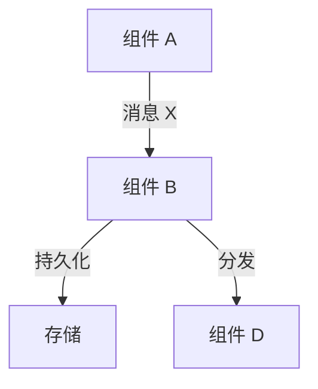

# Work 文档规范

> 本文档定义 `works/` 目录下工作文档（设计、优化、修复、重构、测试等）的格式规范、章节结构、生命周期及撰写行为指南。面向 AI Agent 和人类协作者，目标是所有工作文档结构一致、可检索、可演进。

---

## 1. Work 文档的定位

Work 文档记录**跨模块的技术决策**——回答「为什么这样做」而非「代码怎么写的」。它与模块文档的分工：

| 文档类型 | 目录 | 记录内容 |
|---------|------|---------|
| 工作文档 | `works/` | 决策背景、方案对比、架构权衡、实施规划、代码优化、重构方案 |
| 模块文档 | `modules/` | 模块职责、数据模型、API、业务流程、已知陷阱 |

**何时创建 Work 文档：**
- 引入新的系统或子系统
- 跨多个模块的架构改造
- 存在多个可选方案、需要记录决策理由
- 实施前需要对齐期望、明确验收标准

**何时不需要 Work 文档：**
- 单文件 bug 修复
- 单个模块内部的小范围重构
- 纯配置或常量调整
- 已在模块文档中充分覆盖的内容

---

## 2. 生命周期与状态流转

Work 文档有明确的生命周期，通过 frontmatter 中的 `status` 字段标记：

```
draft → implemented → (archived)
```

| 状态 | 含义 |
|------|------|
| `draft` | 方案讨论中，决策未锁定，代码未开始或部分实施 |
| `implemented` | 代码已完成且与文档描述一致，文档作为决策记录保留 |
| `archived` | （可选）系统被移除或完全重构后，文档不再具有参考价值 |

**状态变更时机：**
- 创建 Work 文档时，`status` 设为 `draft`，`created` 记录首次创建日期
- 代码实施完成、验收通过后，`status` 更新为 `implemented`，`updated` 记录实施完成日期
- 当文档描述与代码产生偏差时，优先以代码为准，然后更新文档

---

## 3. Frontmatter 规范

每份 Work 文档必须以 YAML frontmatter 开头：

```yaml
---
id: <kebab-case-id>           # 唯一标识，与文件名一致（不含 .md）
title: "<标题>"                # 简洁描述
status: draft | implemented   # 生命周期状态
created: YYYY-MM-DD           # 创建日期
updated: YYYY-MM-DD           # 最后更新日期
---
```

**约束：**
- `id` 必须与文件名一致
- `updated` 在每次内容变更时更新
- frontmatter 之后紧跟 `# 标题`（一级标题），与 `title` 字段保持一致
- 一级标题下方紧跟一行 `>` blockquote，用一句话概括文档要解决的问题

---

## 4. 必选章节

以下 5 个章节是所有 Work 文档必须包含的结构性内容。

### 4.1 原始需求（第 1 章）

**目的**：明确问题边界，让读者在不了解上下文的情况下快速理解「为什么要做这个设计」。

**子节结构：**

```
## 1. 原始需求

### 1.1 当前问题
（描述现状的痛点、局限性、无法满足的需求）

### 1.2 期望目标
（描述期望达成的状态，可以是列表或流程图）
```

**规范：**
- `1.1` 必须引用具体的代码位置（用符号名锚定：函数名、类名、常量名）或数据流路径，不得使用模糊描述
- `1.2` 应包含目标架构的数据流/调用链示意图（使用 Mermaid 或 ASCII art）
- 目标描述应可验证——「完成 X 后，可以做到 Y」

### 4.2 现状分析（第 2 章）

**目的**：对受影响系统做详尽的现状描述，作为设计决策的事实基础。

**内容要求：**
- 涉及的关键文件/类/函数，用符号名锚定
- 当前数据流或调用链（使用 Mermaid 或 ASCII art）
- 关键数值或常量的当前值
- 与其他系统的交互点（IPC 接口、数据库 schema、消息格式等）

**规范：**
- 使用表格呈现对比性数据
- 标注**关键事实**——直接影响后续决策的观察结论
- 若涉及多个子系统，可拆分为多个子节

### 4.3 设计方案（第 3 章）

**目的**：完整描述选定的解决方案，包含足够细节使实施者可以开始编码。

**子节结构由具体内容决定，常见模式包括：**
- 数据模型变更
- 调用链 / 数据流变更
- 各子系统改造细节
- 与现有系统的接口约定

**规范：**
- 代码示例使用带语言标记的代码块，注释中标注对应文件路径
- 新增数据结构使用表格描述字段、类型、来源、说明
- 数据流变更使用 Mermaid 或 ASCII art 流程图
- 每个子节只讨论一个独立的子主题

### 4.4 决策汇总（第 4 章）

**目的**：将设计过程中做出的所有决策压缩为一张表格，方便快速查阅。

**格式：**

```
| 编号 | 问题 | 决策 |
|------|------|------|
| Q1  | <问题描述> | <决策结果> |
```

**规范：**
- 每个决策编号（Q1, Q2, ...），可在文档内交叉引用
- 决策描述简洁，一句话说清「选择了什么」
- 若决策存在前提假设（如「具体阈值后续通过性能测试确定」），在决策栏中注明

### 4.5 风险与缓解（倒数第二章）

**目的**：识别设计引入的风险，每个风险附带缓解策略。

**格式：** 编号列表或表格，每项包含**风险描述**和**缓解措施**。

**规范：**
- 风险描述应具体，避免泛泛的「可能影响性能」
- 缓解措施应可执行，不是「多加测试」
- 特别关注本工程的关键风险维度：{{ADAPT: 列出本工程需要特别关注的风险类型，例如：内核态变更的稳定性风险、跨模块 IPC 兼容性、数据格式迁移风险、跨语言 ABI、并发/事务边界等}}

---

## 5. 可选章节

以下章节根据具体设计内容按需加入。

### 5.1 方案比较

当设计过程中存在**多个备选方案**时，使用此章节记录：

- 每个备选方案的简要描述
- 对比矩阵（维度 × 方案）
- 选择当前方案的理由
- 什么情况下应切换到备选方案

### 5.2 新增数据结构

当设计引入**新的数据结构、数据库表或存储 schema**时，使用此章节定义：

- 结构名 / 表名 / key 前缀
- 字段列表（类型、默认值、说明）
- 与其他数据结构的关联
- 序列化/反序列化格式约定

### 5.3 接口 / 协议变更

当设计引入**新的 IPC 接口、消息类型、或跨模块调用约定**时，使用此章节描述：

- 新增或变更的接口签名
- 请求/响应消息格式
- 错误码定义
- 版本兼容策略（新旧版本如何共存）

### 5.4 与现有设计文档的关系

当设计**依赖、修改或替代**已有设计时，使用此章节说明：

- 与哪些 Work 文档存在关联
- 是扩展、替换还是互补
- 对本设计与已有设计的修改点

### 5.5 实施规划

所有设计文档**强烈建议**包含此章节，除非改动范围极其明确且无需分步推进。

**格式：** 分 Phase 描述，每个 Phase 包含：

```
### X.Y Phase N：<标题> [状态标记]

**目标**：<本 Phase 的单一目标>

**改动文件**：

| 文件 | 改动 |
|------|------|
| <路径> | <改动摘要> |

**验收标准**：
- <可验证的条件 1>
- <可验证的条件 2>
```

**规范：**
- 每个 Phase 有独立验收标准，不依赖后续 Phase
- Phase 之间标注依赖关系（`Phase 1 → Phase 2 → Phase 3`）
- 实施完成后，Phase 标题追加 `✅ 已完成` 标记
- 若实施过程中有补充改动，新增子节

### 5.6 实施结果

当 `status` 变更为 `implemented` 时，必须在文档末尾追加此章节。

**内容：**
- 各 Phase 完成状态总览表
- 最终数据流图（Mermaid 或 ASCII art）
- 涉及文件一览
- 实施中修复的关键 bug（如有）

---

## 6. 格式与风格规范

### 6.1 标题层级

- `#` 一级标题：文档标题，仅出现一次
- `##` 二级标题：章节标题
- `###` 三级标题：子节标题
- 最多使用四级标题 `####`

### 6.2 表格

- 表格必须包含表头行和分隔行
- 大表格优先使用表格而非列表

### 6.3 代码块

- 所有代码使用带语言标记的 fenced code block（如 `cpp`、`c`、`go`、`rust`、`ts`、`py`）
- 伪码同样标注语言
- 代码块上方应有说明性文字描述该代码的作用
- 涉及文件路径时在注释中标注（用符号名锚定，不用行号）
- **代码块用于表达方案意图**（如改动前后的代码对比、提案中的伪码），不允许大段粘贴现有代码的逐行解读

### 6.4 图表绘制

遵循 `.meta-knowledge-base-guide.md` §8 的约定：**所有流程图、架构图、时序图、状态图优先使用 Mermaid**。仅当 Mermaid 表达能力确实不足时，降级使用 ASCII art。

**Mermaid 示例（数据流图，请替换为本工程实际组件）：**



**ASCII art 降级条件：**
- 需要在图中嵌入具体变量名、函数名且 Mermaid 节点内文本过长
- 需要精确控制水平/垂直对齐以表达多层嵌套的调用链

### 6.5 文件路径引用

- 所有文件路径使用反引号包裹
- 引用函数时使用符号名（函数名、类名、方法名），**禁止行号引用**
- 跨文档引用使用 Markdown 链接：`[<title>](../modules/<id>.md)`

### 6.6 语言

- 遵循本工程 `.meta-knowledge-base-guide.md` 的语言约定
- 代码标识符（变量名、函数名、类名）保留原始英文
- 首次出现的术语可以使用 `「」` 标注

---

## 7. 撰写行为指南

### 7.1 面向 AI 读者的 Work 文档

设计文档的首要读者是未来的 AI Agent。因此：

- **精确而非笼统**：用符号名而非「XX 函数」
- **引用而非转述**：写代码片段而非「使用默认参数处理」
- **可检索**：代码符号、类名、函数名直接出现在正文中，方便 grep

### 7.2 决策可追溯

- 每个设计决策应关联到具体的「当前问题」或「性能指标」子节
- 若决策来自人类反馈，在决策汇总中引用原始回答

### 7.3 先锁定决策再设计方案

- 涉及架构级决策时，先列出待决策问题，等待人类确认后再进入方案设计
- 技术方案在决策确认前可以并行探索，但不要 deep dive 到代码细节

### 7.4 渐进式细化

- Work 文档不要求一次性完整。可以先写「原始需求 + 现状分析 + 决策汇总」，方案细节在人类确认方向后补充
- 实施过程中发现的偏差和补充改动，追加到「实施规划」或「实施结果」章节

### 7.5 与 index.yaml 同步

- 创建 Work 文档后，必须在 `index.yaml` 中新增对应条目
- 条目放在 `works` 段落下，`type` 设为 `design`
- `keywords` 列出可检索的关键词
- `involves_modules` 列出涉及的模块文档 id

### 7.6 收尾时的知识库关联更新

当 Work 文档 `status` 变更为 `implemented`、确认收尾时，**必须主动提示研发人员**检查以下知识库条目是否需要关联更新：

| 关联条目 | 触发条件 | 更新内容 |
|---------|---------|---------|
| 模块文档 (`modules/`) | 实施过程中修改了模块的 API、数据模型、业务流程或文件清单 | 同步更新对应模块文档的相关章节 |
| 流程文档 (`flows/`) | 实施改变了跨模块流程的调用链或时序 | 更新流程图和步骤说明 |
| 排查文档 (`troubleshooting/`) | 实施修复了已知 bug、或引入了新的常见陷阱 | 将已修复的问题标记为「已解决」并关联 Work 文档；新增引入的已知陷阱 |
| 其他 Work 文档 (`works/`) | 本设计扩展、替换或修改了其他已有设计 | 在相关 Work 文档的「与现有设计文档的关系」章节中补充交叉引用 |
| 研发规范 (`develop/`) | 实施引入了新的编码规范或修改了既有约束 | 同步更新规范文档并注明变更来源 |

**提示方式**：在确认收尾时，逐项列出上述表格中的触发条件，询问研发人员「以下知识库条目是否需要关联更新？」。若研发人员确认不需要更新某项，在对话中记录原因。

**原则**：Work 文档记录决策过程，模块/流程文档是运行时参考。实施完成后，运行时参考必须与代码保持同步 —— 这是知识库可信度的基础。

---

## 8. 检查清单

新建 Work 文档时，按以下清单逐项检查：

- [ ] Frontmatter 包含 id / title / status / created / updated
- [ ] id 与文件名一致
- [ ] 一级标题与 title 一致
- [ ] 标题下方有 blockquote 一句话摘要
- [ ] 第 1 章：原始需求（1.1 当前问题 + 1.2 期望目标）
- [ ] 第 2 章：现状分析（含符号锚定的代码引用、数据表、关键事实）
- [ ] 第 3 章：设计方案（含代码片段、数据结构表、流程图）
- [ ] 第 4 章：决策汇总（表格，每个决策有编号）
- [ ] 倒数第二章：风险与缓解
- [ ] 最后一章：实施规划（分 Phase，每个 Phase 有验收标准）
- [ ] `index.yaml` 已新增对应条目
- [ ] 无拼写错误、无损坏的跨文档链接
- [ ] 无行号引用（用符号名锚定代码）
- [ ] （收尾时）已检查知识库关联更新（见 §7.6）
